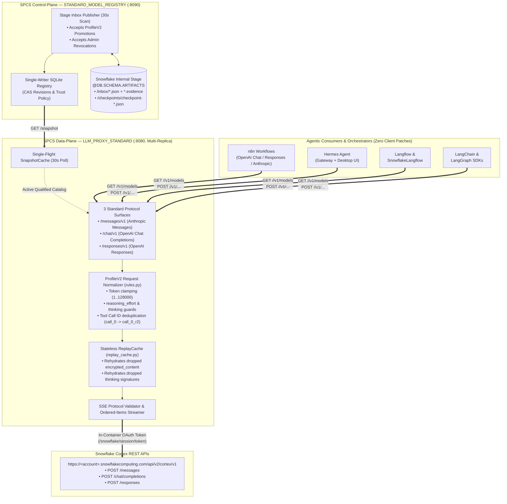
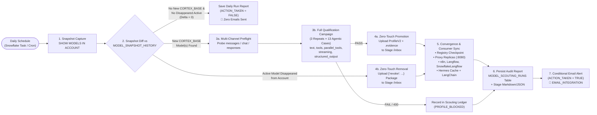
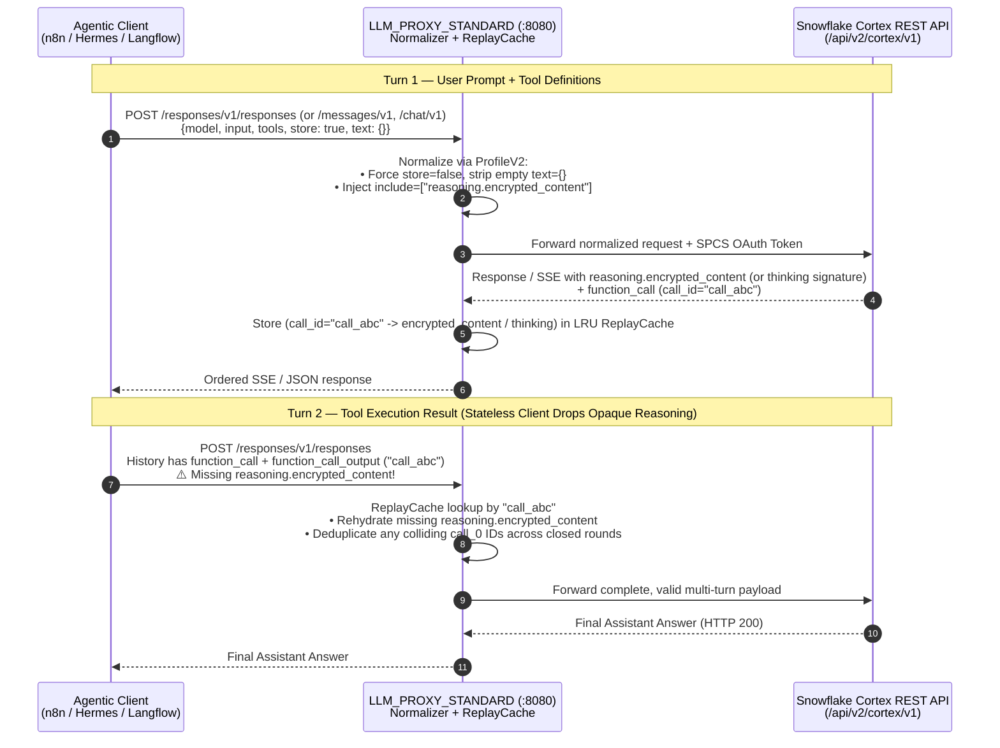

<div align="center">

# Snowflake Cortex REST API — Universal LLM Proxy & Autonomous Model Registry

**Protocol-Validating Data-Plane, Zero-Touch Model Governance & Daily Autonomous Model Scouting for Snowflake Cortex REST APIs on Snowpark Container Services (SPCS)**

[-success?style=for-the-badge)](LICENSE)
[](pyproject.toml)
[](https://docs.snowflake.com/en/user-guide/snowflake-cortex/cortex-rest-api)
[](#1-high-level-architecture)
[](#quickstart--offline-verification)

</div>

---

> [!WARNING]
> ### IMPORTANT DISCLAIMER — NOT AN OFFICIAL SNOWFLAKE PRODUCT
> **This repository is an independent, open-source community and field-engineering reference implementation** built on top of public **Snowflake Cortex REST APIs** (`/api/v2/cortex/v1`) and **Snowpark Container Services (SPCS)**.
> - It is **NOT an official Snowflake Inc. product** and is **NOT part of the commercial Snowflake service offering**.
> - It carries **NO official Snowflake SLA, warranty, or technical support commitment**.
> - It is provided strictly **"AS IS"** for educational, architectural, and operational acceleration. Review, test, and validate all code against your organization's security and governance policies before deploying in production.

> [!TIP]
> ### FREE & OPEN-SOURCE LICENSE (MIT)
> This project is released under the permissive **[MIT License](LICENSE)** (**100% free and open-source**). You are free to **use, copy, modify, fork, integrate, and deploy** it in personal, internal, or commercial environments without royalty or licensing restrictions.

---

## Table of Contents

1. [Overview & Problem Statement](#overview--problem-statement)
2. [High-Level System Architecture (Visual Schematics)](#1-high-level-architecture)
3. [Autonomous Daily Model Scouting, Promotion & Removal Pipeline](#2-autonomous-daily-model-scouting-promotion--removal-pipeline)
4. [Request Normalization & Stateless Replay Flow](#3-request-normalization--stateless-replay-flow)
5. [Prerequisite: Cross-Region Inference (`ANY_REGION`)](#prerequisite-enable-cross-region-inference-any_region)
6. [Multi-Consumer Ecosystem (`n8n`, `Hermes`, `Langflow`, `SnowflakeLangflow`, `LangChain`)](#multi-consumer-ecosystem)
7. [Repository Structure](#repository-structure)
8. [Quickstart & Offline Verification](#quickstart--offline-verification)
9. [License & Legal Disclaimer](#license--legal-disclaimer)

---

## Overview & Problem Statement

When connecting standard agentic frameworks and orchestrators (**n8n**, **Hermes**, **Langflow**, **SnowflakeLangflow**, **LangChain / LangGraph**) directly to the **Snowflake Cortex REST API** (`/api/v2/cortex/v1`), teams typically encounter five recurring integration barriers:

| Challenge | What Unmodified Clients Send | How `snowflake-proxy-cortexrestapi` Solves It |
|---|---|---|
| **1. SPCS OAuth vs Static SDK Auth** | Standard OpenAI/Anthropic SDKs expect a static `Bearer` key, while SPCS containers authenticate via rolling `/snowflake/session/token` (`OAUTH`). | Terminates internal SPCS traffic and automatically injects the fresh in-container OAuth token (`X-Snowflake-Authorization-Token-Type: OAUTH`) upstream. |
| **2. Client Parameter Conflicts (`HTTP 400`)** | `store: true` and empty `"text": {}` (n8n Responses), `reasoning_effort` on models that reject it or require `"none"`, `temperature` alongside extended `thinking`, or oversized token budgets. | **`ProfileV2` Normalization** rewrites, clamps (`1..128000`), or strips incompatible client hints before upstream forwarding. |
| **3. Responses SSE Event Ordering** | `langchain-openai` requires strictly ordered output items and finalized `reasoning.encrypted_content` at item boundaries. | **`ordered-items` Stream Normalizer** buffers and emits deterministic SSE item lifecycles for Responses streams. |
| **4. Stateless Tool-Loop Stripping** | Unpatched orchestrators drop `reasoning.encrypted_content` (Responses) or `thinking` / `signature` blocks (Messages) between tool turns. | **In-Memory LRU `ReplayCache`** keys opaque reasoning/thinking blocks by `call_id` / `tool_use.id` and rehydrates them on the next turn. |
| **5. Model Lifecycle Drift** | New Cortex models appear in `SHOW MODELS IN ACCOUNT` or legacy models are retired, requiring manual testing and config edits across every tool. | **Daily Autonomous Scouting Task** diffs `SHOW MODELS IN ACCOUNT`, qualifies new models on `messages` / `chat` / `responses`, promotes passing models zero-touch, revokes disappeared models, and notifies **only when an action occurs**. |

---

## 1. High-Level Architecture



### ASCII Quick-Reference Diagram

```text
+---------------------------------------------------------------------------------------------------+
|                     AGENTIC CONSUMERS (n8n, Hermes, Langflow, SnowflakeLangflow, LangChain)       |
+-------------------------------------------------+-------------------------------------------------+
                                                  |
                  GET /{messages,chat,responses}/v1/models  (Live Dynamic Discovery)
                  POST /{messages,chat,responses}/v1/...    (Standard SDK Requests)
                                                  |
                                                  v
+---------------------------------------------------------------------------------------------------+
|  LLM_PROXY_STANDARD (:8080, Replicated Data-Plane)                                                |
|  +-----------------------------+  +------------------------------+  +--------------------------+  |
|  | ProfileV2 Option Normalizer |  | LRU ReplayCache (512 / 1h)   |  | Ordered-Items SSE Engine |  |
|  | - Clamps token budgets      |  | - Rehydrates encrypted_      |  | - Validates framing      |  |
|  | - Fixes reasoning/thinking  |  |   content & thinking blocks  |  | - Deterministic item     |  |
|  | - Dedupes tool call IDs     |  |   dropped by stateless tools |  |   ordering for LangChain |  |
|  +-----------------------------+  +------------------------------+  +--------------------------+  |
+------------------------+-------------------------------------------------+------------------------+
                         |                                                 |
       Polls GET /snapshot every 30s                         Forwards with SPCS OAuth Token
                         |                                                 |
                         v                                                 v
+------------------------------------------------+   +----------------------------------------------+
|  STANDARD_MODEL_REGISTRY (:8090, Single-Writer)|   |  SNOWFLAKE CORTEX REST API                   |
|  - Scans Stage /inbox/*.json every 30s         |   |  /api/v2/cortex/v1/messages                  |
|  - Validates ProfileV2 & Revocation packages   |   |  /api/v2/cortex/v1/chat/completions          |
|  - Writes immutable checkpoint-<gen>-<sha>.json|   |  /api/v2/cortex/v1/responses                 |
+------------------------------------------------+   +----------------------------------------------+
```

---

## 2. Autonomous Daily Model Scouting, Promotion & Removal Pipeline

The repository includes an end-to-end daily automation pipeline (`scripts/daily_scout_and_promote.py`, `scripts/spcs_scout_worker.py`, and `deployment/setup_daily_scout_task.sql.template`) that keeps the proxy and all downstream consumers automatically synchronized with your Snowflake account's available Cortex models:



### How the Daily Automation Works Step-by-Step

1. **Daily Snapshot & Diff (`SHOW MODELS IN ACCOUNT`):**
   - Captures all models available in the Snowflake account and compares them against the previous snapshot stored in `MODEL_SNAPSHOT_HISTORY` and on stage.
   - Identifies **newly added `CORTEX_BASE` models** and **active proxy models that disappeared** from `SHOW MODELS IN ACCOUNT`.
2. **Multi-Channel Discovery & Qualification (`messages`, `chat`, `responses`):**
   - Each new `CORTEX_BASE` model is probed across its candidate Cortex REST API channels (`claude-*` &rarr; `messages`; `openai-gpt-*` &rarr; `responses` then `chat`; other families &rarr; `chat`, `responses`, `messages`).
   - Responsive channels undergo a **3-repeat qualification campaign** (via the **`cortex-model-compatibility-matrix`** qualification harness) testing synchronous text, SSE streaming, multi-turn history, single tool roundtrip, parallel tool roundtrip, streamed parallel tool roundtrip, tool error recovery, and JSON schema structured output.
3. **Zero-Touch Promotion (`ProfileV2`):**
   - Models that pass qualification are packaged into a content-addressed `ProfileV2` bundle (`<sha256>.json` + `.evidence`) and uploaded to the Registry stage inbox (`/inbox/`).
   - Within 30–60 seconds, `STANDARD_MODEL_REGISTRY` commits the new generation (`checkpoint-<gen>-<sha256>.json`) and all `LLM_PROXY_STANDARD` replicas expose the new model on `GET /<protocol>/v1/models` with **zero container restarts**.
4. **Automatic Removal of Disappeared Models (`--revoke`):**
   - If a previously active model disappears from `SHOW MODELS IN ACCOUNT`, the orchestrator generates an administrative revocation package (`{"revoke": {"id": "<model>", "expected_revision": "<rev>", ...}}`) and drops it into the stage inbox.
   - `Publisher.consume()` revokes the model in SQLite, writes a new checkpoint, and removes the model from all proxy `/models` endpoints and downstream consumers.
5. **Per-Run Report Persistence & Action-Only Notifications:**
   - **Every run** (even when nothing changes) writes a full structured JSON + Markdown report to `MODEL_SCOUTING_RUNS` (viewable via `V_LATEST_MODEL_SCOUTING_REPORT`) and to the Snowflake stage.
   - **Email notifications** (`SYSTEM$SEND_SNOWFLAKE_NOTIFICATION` via `SNOWFLAKE.NOTIFICATION.EMAIL_INTEGRATION_CONFIG`) are triggered **exclusively when `ACTION_TAKEN = TRUE`** (a new model was tested/promoted/blocked, or a disappeared model was revoked). Runs with `Delta = 0` send **zero emails**.

---

## 3. Request Normalization & Stateless Replay Flow



---

## Prerequisite: Enable Cross-Region Inference (`ANY_REGION`)

To maximize model availability across all three APIs (`Messages`, `Chat`, and `Responses`) on your Snowflake account, enable **Cross-Region Inference** (`ANY_REGION`) when your organization's compliance policy permits:

```sql
SHOW PARAMETERS LIKE 'CORTEX_ENABLED_CROSS_REGION' IN ACCOUNT;

-- With ACCOUNTADMIN privileges:
ALTER ACCOUNT SET CORTEX_ENABLED_CROSS_REGION = 'ANY_REGION';
```

See the [Snowflake Cross-Region Inference documentation](https://docs.snowflake.com/en/user-guide/snowflake-cortex/cross-region-inference) for regional options (`AWS_US`, `AWS_EU`, `ANY_REGION`).

---

## Multi-Consumer Ecosystem

All connected consumers discover newly promoted models (and drop revoked models) automatically from the proxy's `/models` endpoints:

| Consumer | Protocol Surface(s) Used | Dynamic Discovery Mechanism |
|---|---|---|
| **n8n** | `/chat/v1`, `/responses/v1`, `/messages/v1` | Queries `GET /<protocol>/v1/models` live when opening the model selector in OpenAI / Anthropic credentials. |
| **Langflow & SnowflakeLangflow** | `/chat/v1`, `/responses/v1`, `/messages/v1` | Queries `GET /<protocol>/v1/models` and dynamically inspects `metadata.constraints` (e.g., `reasoning_effort` values) to configure model parameters automatically. |
| **Hermes Agent** | `/chat/v1`, `/responses/v1`, `/messages/v1` | Uses `discover_models: true` across `snowflake-standard-chat`, `snowflake-standard-responses`, and `snowflake-standard-messages`. |
| **LangChain / LangGraph** | `/chat/v1`, `/responses/v1`, `/messages/v1` | Uses `ChatOpenAI(..., use_responses_api=True/False)` and `ChatAnthropic` against the proxy URLs (`examples/standard_clients.py`). |

---

## Repository Structure

```text
snowflake-proxy-cortexrestapi/
├── LICENSE                                         # MIT License (Free & Open Source) + Non-Official Disclaimer
├── README.md                                       # Architecture, visual schematics, and operational guide
├── Dockerfile                                      # Production SPCS image (32 MiB payload, 600s deadline)
├── pyproject.toml                                  # Python package metadata
├── src/llm_proxy_standard/
│   ├── app.py                                      # FastAPI data-plane (/chat/v1, /responses/v1, /messages/v1)
│   ├── rules.py                                    # ProfileV2 client option normalizer & tool-ID deduplicator
│   ├── replay_cache.py                             # Bounded LRU cache for stateless client tool roundtrips
│   ├── protocol.py                                 # Incremental SSE & JSON framing validator
│   ├── stream_order.py                             # Ordered-items SSE normalizer for Responses API
│   ├── contracts.py                                # Pydantic contracts (ProfileV2, Entry, Snapshot, Evidence)
│   ├── registry.py                                 # Single-writer SQLite registry with CAS & revocation
│   ├── registry_service.py                         # FastAPI control-plane (:8090 /snapshot, /readyz)
│   ├── publisher.py                                # Stage inbox scanner (promotions & revocations) + checkpointer
│   ├── cache.py                                    # Single-flight SnapshotCache for serving replicas
│   └── admin.py                                    # Trust policy & evidence bundle verifier
├── scripts/
│   ├── promote_model.py                            # Zero-touch CLI for ProfileV2 promotion & model revocation
│   ├── daily_scout_and_promote.py                  # Daily account snapshot diff, qualification, promotion & alert CLI
│   └── spcs_scout_worker.py                        # Autonomous SPCS Job Worker for scheduled Snowflake Tasks
├── deployment/
│   ├── service-spec.yaml.template                  # SPCS service specification template (Proxy + Registry)
│   ├── setup_daily_scout_task.sql.template         # SQL template for tables, view, stored procedure & daily Task
│   └── trust-empty.json                            # Baseline Registry trust configuration template
├── examples/
│   └── standard_clients.py                         # Reference client factories for OpenAI, Anthropic, LangChain
├── docs/
│   ├── ARCHITECTURE.md                             # Deep-dive into data-plane, control-plane & stream ordering
│   ├── CONSUMERS.md                                # Integration guide for n8n, Hermes, Langflow & LangChain
│   └── PROMOTION.md                                # Manual & automated daily model scouting/promotion runbook
└── tests/                                          # 91 offline unit & integration tests (zero network required)
```

---

## Quickstart & Offline Verification

Requirements: Python 3.11+. The offline test suite uses synthetic fixtures only and requires no Snowflake credentials or network access:

```bash
git clone <REPOSITORY_URL>/snowflake-proxy-cortexrestapi.git
cd snowflake-proxy-cortexrestapi
python3 -m venv .venv
.venv/bin/pip install -r requirements.test.lock -e .
LANGSMITH_TRACING=false LANGCHAIN_TRACING_V2=false .venv/bin/python -m unittest discover -s tests -t . -v
```

### Run Daily Model Scouting & Promotion

```bash
python scripts/daily_scout_and_promote.py \
  --account <YOUR_ACCOUNT_LOCATOR> \
  --host <your-org>-<your-account>.snowflakecomputing.com \
  --connection <your_snow_cli_connection> \
  --stage @YOUR_DB.YOUR_SCHEMA.LLM_PROXY_ARTIFACTS \
  --inbox-prefix inbox \
  --scout-schema YOUR_DB.PUBLIC \
  --artifact <64-hex-proxy-artifact-digest> \
  --approver <YOUR_ADMIN_USER> \
  --notification-integration <YOUR_EMAIL_INTEGRATION> \
  --notification-email <your-verified-email@example.com>
```

### Build the Container Image for SPCS (`linux/amd64`)

```bash
docker build --platform linux/amd64 -t snowflake-proxy-cortexrestapi:latest .
```

---

## License & Legal Disclaimer

### Open-Source License (MIT)
This project is licensed under the **[MIT License](LICENSE)** — a permissive, free software license. You may freely use, copy, modify, merge, publish, distribute, sublicense, and/or sell copies of the software, subject only to preserving the copyright and permission notice in [`LICENSE`](LICENSE).

### Non-Official Product Disclaimer
> [!IMPORTANT]
> **No Official Snowflake Endorsement or Support:**
> This repository and all accompanying scripts, container definitions, and documentation are community-contributed reference materials. They are **not** authored, certified, warranted, or supported by **Snowflake Inc.** as part of any commercial Snowflake product or service agreement. All trademarks and registered trademarks are the property of their respective owners.
