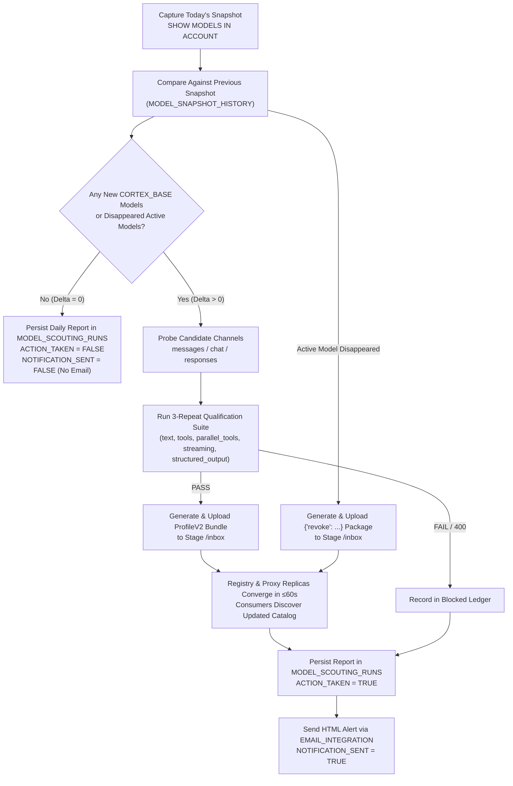

# Model Qualification, Automated Daily Scouting & Zero-Touch Promotion / Removal

> [!WARNING]
> **Disclaimer:** This project is an independent, open-source community and field-engineering implementation built on top of Snowflake Cortex REST APIs and Snowpark Container Services (SPCS). It is **NOT an official Snowflake product**, carries no official Snowflake warranty or support, and is released under the free and open-source **[MIT License](../LICENSE)**.

---

## 1. Prerequisite: Cross-Region Inference (`ANY_REGION`)

Before qualifying or promoting models on your Snowflake account, verify that Cross-Region Inference is enabled (recommended: `ANY_REGION` where permitted by your compliance requirements):

```sql
SHOW PARAMETERS LIKE 'CORTEX_ENABLED_CROSS_REGION' IN ACCOUNT;
ALTER ACCOUNT SET CORTEX_ENABLED_CROSS_REGION = 'ANY_REGION';
```

---

## 2. Automated Daily Scouting, Promotion & Removal (`scripts/daily_scout_and_promote.py`)

Instead of manually checking for new models, you can run the automated daily scouting pipeline either via **Snowflake Scheduled Task** (`deployment/setup_daily_scout_task.sql.template` + `scripts/spcs_scout_worker.py`) or via **CLI / Desktop Automation** (`scripts/daily_scout_and_promote.py`).

### Pipeline Decision Flow



### Deploy the Snowflake Tables, View, Stored Procedure & Scheduled Task

1. Upload `scripts/spcs_scout_worker.py` to your artifacts stage:
   ```sql
   PUT 'file://scripts/spcs_scout_worker.py' @<DB>.<SCHEMA>.<ARTIFACTS_STAGE>/scouting AUTO_COMPRESS=FALSE OVERWRITE=TRUE;
   ```
2. Replace the placeholders in `deployment/setup_daily_scout_task.sql.template` (`<DB>`, `<SCHEMA>`, `<WAREHOUSE>`, `<COMPUTE_POOL>`, `<ARTIFACTS_STAGE>`, `<QUALIFICATION_IMAGE>`, `<EMAIL_INTEGRATION>`, `<RECIPIENT_EMAIL>`) and deploy:
   ```bash
   snow sql --enable-templating NONE -f deployment/setup_daily_scout_task.sql
   snow sql -q "ALTER TASK <DB>.<SCHEMA>.DAILY_MODEL_SCOUT_TASK RESUME;"
   ```
3. Inspect run reports at any time:
   ```sql
   SELECT * FROM <DB>.<SCHEMA>.V_LATEST_MODEL_SCOUTING_REPORT;
   ```

---

## 3. Manual Zero-Touch Promotion (`scripts/promote_model.py`)

You can also promote a single qualified model manually without restarting any SPCS service:

```bash
python scripts/promote_model.py \
  --model <model-id> \
  --protocol <chat|responses|messages> \
  --account <YOUR_ACCOUNT_LOCATOR> \
  --upstream https://<your-org>-<your-account>.snowflakecomputing.com/api/v2/cortex/v1 \
  --artifact <64-hex-artifact-digest> \
  --expected-revision <current-registry-revision> \
  --approver <YOUR_ADMIN_IDENTITY> \
  --output-dir ./out-package \
  --stage-inbox @YOUR_DB.YOUR_SCHEMA.YOUR_STAGE/inbox \
  --connection <your_snow_cli_connection>
```

---

## 4. Zero-Touch Model Revocation (`scripts/promote_model.py --revoke`)

When a model is retired or removed from your Snowflake account, revoke it zero-touch via the stage inbox:

```bash
python scripts/promote_model.py \
  --revoke \
  --model <model-id> \
  --account <YOUR_ACCOUNT_LOCATOR> \
  --expected-revision <current-registry-revision> \
  --approver <YOUR_ADMIN_IDENTITY> \
  --reason "Model retired from account" \
  --output-dir ./out-revoke \
  --stage-inbox @YOUR_DB.YOUR_SCHEMA.YOUR_STAGE/inbox \
  --connection <your_snow_cli_connection>
```
